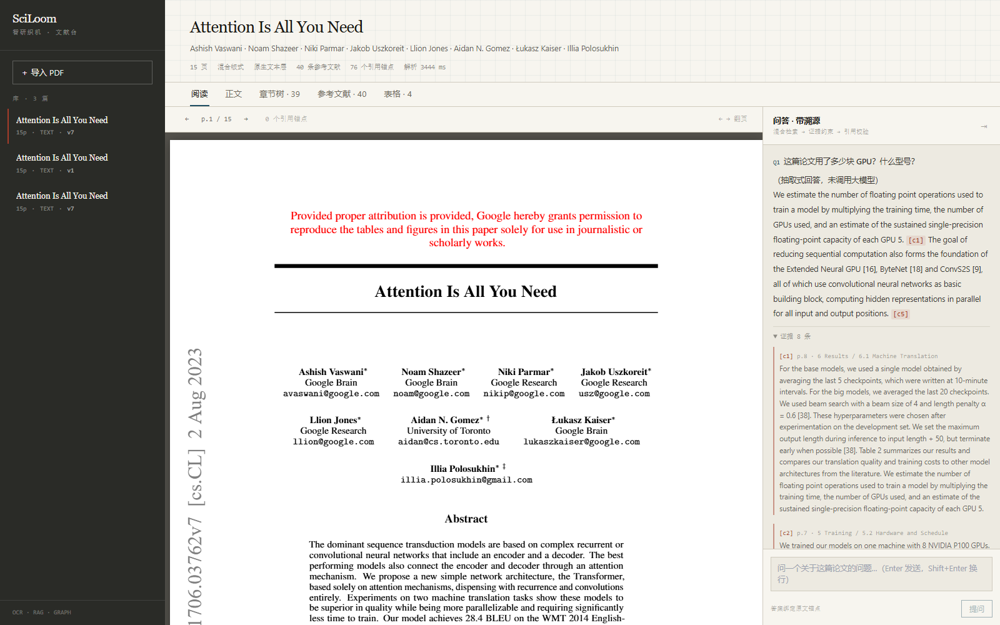
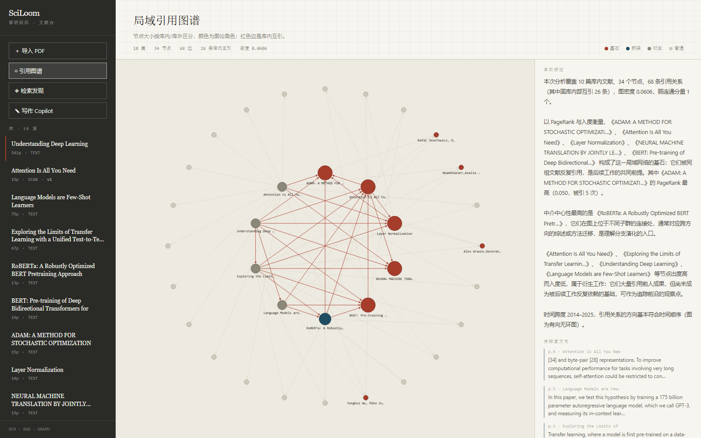
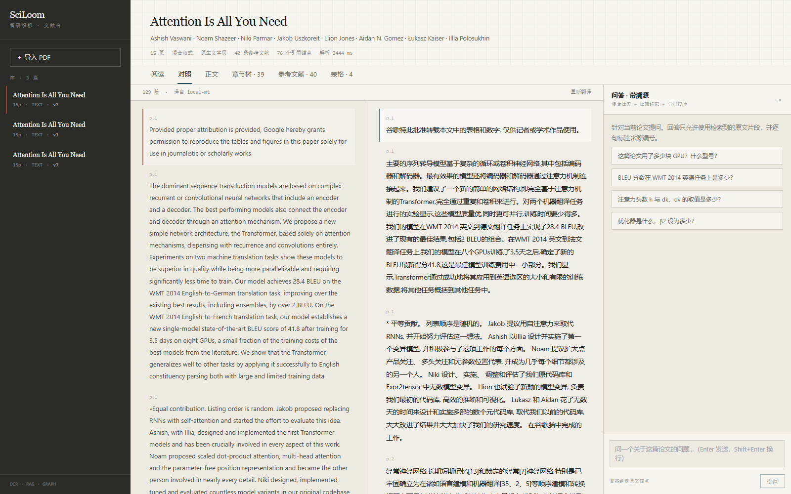
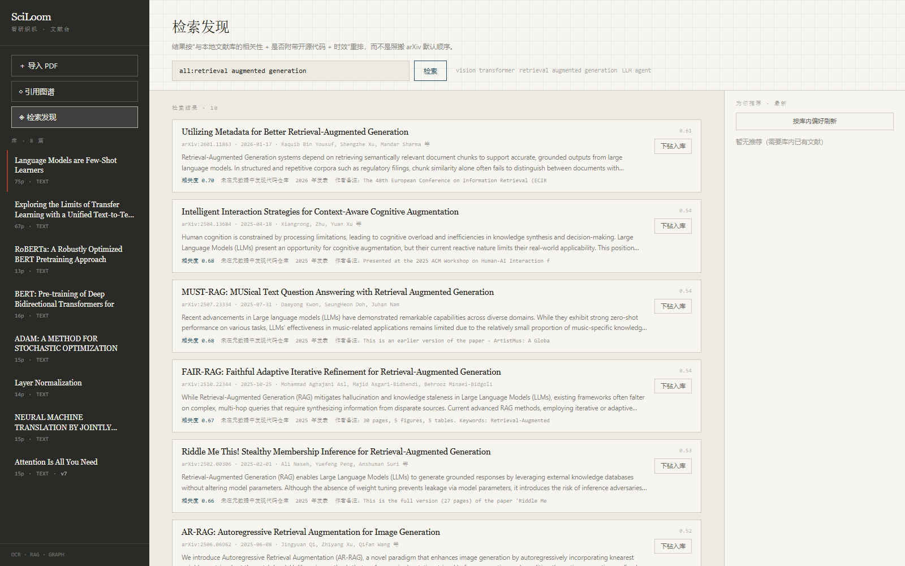
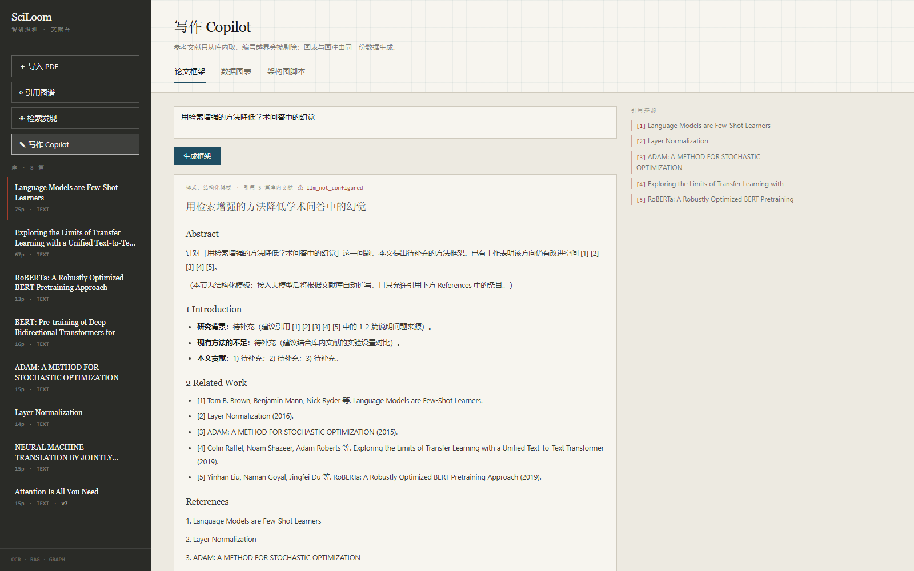

# SciLoom · 智研织机

> 全国高校 AI 大模型挑战赛 · 智领科研·意图驱动
> 基于大模型与 Agent 架构的全流程科研助手

SciLoom 把一篇论文从"下载"到"写成综述"织成一条可追溯的链路：**解析 → 检索 → 问答溯源 → 对照阅读 → 图谱洞察 → 写作成图**。

与"PDF + 聊天框"不同：每一个结论都能回到原文的页码与段落锚点；参考文献只能来自你真正读过的库内文献；没有大模型时它会明确告诉你"这是抽取式结果"，而不是假装生成。



---

## 六大模块

| 模块 | 已实现 | 关键设计 |
|---|---|---|
| ① 文献管理与解析 | 批量上传、语义去重、版本差异、标题树、表格、参考文献、扫描件 OCR | 段落级 8-gram shingle + SimHash 判定重复；行级重建还原双栏 |
| ② 抗幻觉问答 | 混合检索、证据约束、引用白名单、拒答、SSE 流式、**跨文献对比** | 稠密召回 + 短名单内 BM25 重排；多篇证据统一编号后做维度化对比 |
| ③ 阅读与翻译 | PDF 渲染、锚点叠加、章节/引用/证据跳转、中英段落对照、同步滚动、**划词翻译** | 解析坐标与渲染共用一套坐标系；按块索引对齐；文本层支持划词即时翻译 |
| ④ 检索与推荐 | arXiv 检索、相关性重排、代码可复现性加权、一键下钻入库 | 0.65 库内相关性 + 0.20 开源代码 + 0.15 时效 |
| ⑤ 图谱与综述 | 引用网络、PageRank 角色、结构化综述、Future Work 抽取 | 分位数划分基石/桥梁/衍生，综述由图谱统计生成 |
| ⑥ 写作与可视化 | 无幻觉框架、CSV 学术图表与图注、TikZ/Mermaid/Graphviz | 引用越界剔除；量级差 20 倍自动拆子图 |

### 界面一览

| | |
|---|---|
|  |  |
| 局域引用图谱与自动综述 | 中英段落对照与同步滚动 |
|  |  |
| arXiv 检索与个性化推荐 | 论文框架与库内引用 |

---

## 技术栈

| 层 | 选型 | 说明 |
|---|---|---|
| 前端 | Next.js 14 · TypeScript · Tailwind · PDF.js · Cytoscape | App Router + SSE 流式 |
| 后端 | FastAPI · Python 3.11 | 解析、检索、OCR、翻译、图谱、写作 |
| 模型 | DeepSeek-V3（生成）· BGE-M3（向量）· opus-mt-en-zh（离线翻译）· RapidOCR | 全部可降级 |
| 存储 | SQLite + JSON 解析结果 + npz 向量 | 零运维，单机可复现 |

---

## 快速开始

```bash
# 1. 后端
cd apps/api
python -m venv .venv
.venv\Scripts\activate                  # macOS/Linux: source .venv/bin/activate
pip install -e ".[rag,graph,viz]"
uvicorn app.main:app --reload --port 8000

# 2. 前端
cd apps/web
npm install
npm run dev                             # http://localhost:3000

# 3. 准备演示数据（可选）
python scripts/fetch_data.py            # 官方测试集
python scripts/seed_demo.py             # 灌入 9 篇论文并建索引
```

Windows 下也可以用一键脚本：

```powershell
& .\scripts\start.ps1     # 启动后端 + 前端，日志在 docs/
& .\scripts\stop.ps1      # 按端口停止
```

首次启动会加载 BGE-M3（约 15–20 秒）。没有配置 `LLM_API_KEY` 时，问答自动回落为**抽取式模式**、翻译回落为**本地 MT**、写作回落为**结构化模板**，界面上会明确标注。

---

## 环境变量

复制 `.env.example` 为 `.env`：

```ini
LLM_BASE_URL=https://api.deepseek.com/v1
LLM_API_KEY=sk-***            # 留空则降级为抽取式
LLM_MODEL=deepseek-chat

EMBEDDING_BACKEND=local
EMBEDDING_MODEL=BAAI/bge-m3
HF_ENDPOINT=https://hf-mirror.com
HF_OFFLINE=false              # 模型缓存后可置 true

CHUNK_SIZE=800
CHUNK_OVERLAP=120
TRANSLATION_BACKEND=auto      # auto | llm | local
```

> 密钥只存在于 `.env`（已被 `.gitignore` 排除）；仓库内只有 `.env.example` 模板。

---

## 实测数据

| 指标 | 结果 | 复现脚本 |
|---|---|---|
| 541 页教材解析 | 29.3 s，峰值内存 24.3 MB | `scripts/parse_probe.py` |
| 15 页论文解析 | 6–8 s，40 条参考文献、76 个字符级锚点 | 同上 |
| 扫描件 OCR | 15 页纯图片解析出 7 章、36 条参考文献 | 同上 |
| 检索命中 @3 | 6/6（含中文提问） | `scripts/eval_retrieval.py` |
| 版本去重 | v1 vs v7：`same_work`，相似度 0.905 | `scripts/dedupe_test.py` |
| 引用图谱 | 33 节点 / 52 边 / 16 条库内互引 | `scripts/graph_probe.py` |

---

## 目录结构

```
.
├── apps/
│   ├── api/            # FastAPI：core / models / routers / services
│   └── web/            # Next.js：app / components / lib
├── pdf/                # 官方测试集（不入库）
├── scripts/            # 取数、评测、探针、启停
├── deploy/             # nginx 配置
├── docs/               # 技术文档、部署手册、视频脚本
└── docker-compose.yml
```

---

## 部署

见 [`docs/DEPLOY.md`](docs/DEPLOY.md)。三容器（api / web / nginx），模型与数据挂卷，SSE 关闭缓冲。

```bash
docker compose build && docker compose up -d
python scripts/seed_demo.py http://<公网IP>
```

---

## 已知局限

- **Future Work 的"已解决 idea 过滤"**只做到抽取与展示，尚未做后续论文反查。
- **OCR 速度**约 7 s/页（CPU），整本扫描书需后台队列；扫描件的 OCR 文本词间空格不可靠，会影响该篇的检索质量。
- **公式**仅按字体启发式识别，未还原 LaTeX。
- 单用户单库，尚无账号体系。
- 532 页以上的超长文档默认不建向量索引（CPU 上需数十分钟），只演示解析。

---

## 团队

- 参赛者：（填写姓名）
- 组别：**B 组**（普通本科院校本科生组，已报名并缴费）
- 省赛提交截止：2026-11-18

## 文档

- 技术文档（PDF，20 页）：[`docs/SciLoom-技术文档.pdf`](docs/SciLoom-技术文档.pdf)
- 部署手册：[`docs/DEPLOY.md`](docs/DEPLOY.md)
- 演示视频脚本：[`docs/VIDEO_SCRIPT.md`](docs/VIDEO_SCRIPT.md)
- 开发进度：[`docs/PROGRESS.md`](docs/PROGRESS.md)
